<!-- ========================================================= -->
<!-- AMAAN UDDIN AHMED — NEON GITHUB PROFILE                    -->
<!-- Repository: Amaanuddin-Ahmed/Amaanuddin-Ahmed              -->
<!-- Keep glowing-border.svg in the repository root.           -->
<!-- ========================================================= -->

<!-- ORIGINAL ANIMATED PROFILE SVG -->

 

<!-- ========================================================= -->
<!-- TECHNOLOGY STACK                                           -->
<!-- ========================================================= -->

<h2>⚡ Tech Stack &amp; Skills</h2>

  Languages · Frameworks · Developer Tools · Databases

<!-- ================= PROGRAMMING LANGUAGES ================== -->

<h3>💻 Languages</h3>

  
  &nbsp;
  
  &nbsp;
  
  &nbsp;
  
  &nbsp;
  
  &nbsp;
  

  
  
  
  
  
  

<!-- ================= FRAMEWORKS ============================= -->

<h3>🧩 Frameworks &amp; Web</h3>

  
  &nbsp;
  
  &nbsp;
  

  
  
  
  

<!-- ================= TOOLS ================================== -->

<h3>🛠️ Tools &amp; Platforms</h3>

  
  &nbsp;
  
  &nbsp;
  
  &nbsp;
  
  &nbsp;
  
  &nbsp;
  

<!-- NetBeans uses a Shields.io badge for its icon. -->

  
  
  
  
  
  
  

<!-- ================= DATABASES AND CLOUD =================== -->

<h3>🗄️ Databases &amp; Cloud</h3>

  

  
  
  
  

  
    ⚡ Building skills through practice, experimentation, debugging,
    and continuous learning.
  

---

<!-- ========================================================= -->
<!-- GITHUB ACTIVITY GRAPH                                      -->
<!-- ========================================================= -->

<h2>📈 GitHub Activity</h2>

  
    My GitHub contribution activity over time — just the graph,
    without streak cards, grades, trophies, or extra statistics.
  

<!-- Main activity graph -->

  

  
    If the graph service is temporarily unavailable, use the link above
    to see contribution activity directly on GitHub.
  

---

<!-- ========================================================= -->
<!-- CONNECT WITH ME                                            -->
<!-- ========================================================= -->

<h2>🤝 Connect With Me</h2>

  Have an idea, project, or opportunity? Let's connect.

  

  

  

&nbsp;&nbsp;&nbsp;

&nbsp;&nbsp;&nbsp;

  

<!-- ANIMATED FOOTER -->

<b>Built with curiosity. Improved with code. Powered by coffee. ☕</b>

Keep learning · Keep creating · Keep shipping

© Amaan Uddin Ahmed

